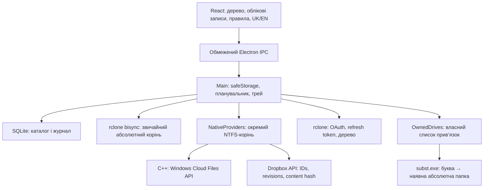

# Архітектура AMG rclone UI

Документ описує версію 0.21.0 (04.11.2026). Поточна збірка — Windows x64; File Provider для macOS відкладено (ROADMAP, етап 5). Звіти перевірок кожної версії — у `docs/verification/`.

**Основний двигун — нативний Windows-провайдер.** Він вмикається автоматично при першому виборі порожньої папки на Windows. rclone bisync заморожено: лише виправлення помилок, без нових можливостей; він залишається запасним варіантом для macOS до готовності File Provider.

Зміни після 0.14.0, коротко: профіль у `Документи\AMGRCLONE` з міграцією зі `%APPDATA%\cloudlane` і знімками перед оновленням (0.15.0); журнал файлів з утриманням 30 днів / 100 000 подій; автоматичний вибір кореня особистого чи командного простору Dropbox; безпечний вихід і скидання зі збереженням завантажених файлів; пропуск імен, недопустимих у Windows, із захистом локальних копій (0.16.5).

## Незмінна ієрархія та subst

Жодна команда створення диска не змінює `settings.localRoot`, правила, дерево або відносні шляхи. Windows `subst` пов’язує букву з локальною папкою; `/D` знімає лише цю прив’язку. [Синтаксис Microsoft](https://learn.microsoft.com/en-us/windows-server/administration/windows-commands/subst).

`OwnedDrives` зберігає випадковий ID, account ID, окремий owner cookie, букву, початковий абсолютний корінь і підпапку. Створення: перевірка шляху всередині кореня через realpath, перевірка вільної букви, збереження наміру, запуск справжнього subst.exe через execFile без shell, перевірка фактичної цілі. Видалення: лише ID зі свого реєстру, перевірка owner і точного QueryDosDevice target, потім subst /D. Видалення довільної букви API не надає. `QueryDosDevice` використовується тільки для читання стану; DefineDosDevice для створення/видалення не використовується.

Після виходу прив’язка залишається в поточному сеансі. На старті відновлюються лише збережені власні записи; зайнята іншим шляхом буква має стан blocked. Файлова ієрархія не видаляється. При видаленні облікового запису з його дисками операція блокується до відключення цих записів.

## Два окремі двигуни синхронізації

rclone bisync працює з поточними/попередніми listing, потребує початкового resync і окремого відновлення після небезпечних помилок. Фільтри й пара шляхів потребують сталого стану. Це періодичний двигун, а не файловий провайдер. [Документація bisync](https://rclone.org/bisync/).

У проєкті звичайний режим має постійний workdir на пару, одноразовий план із терміном дії, backup-dir з обох боків, access markers, max-delete 10%, історію й підтверджене відновлення. Автоматичного force/resync немає. Гілки зі змішаним online-only/виключеннями не передаються до bisync. Перед файловими операціями перевіряється, чи корінь не зареєстровано як системний cloud sync root.

Native mode облікового запису взаємно виключає bisync. Окремий порожній NTFS-корінь реєструє C++ helper через CfRegisterSyncRoot/CfConnectSyncRoot, створює CfCreatePlaceholders, повертає діапазони CfExecute і виконує pin/hydrate/unpin/dehydrate. Windows надає прозоре читання placeholders і локально закріплені файли. [Огляд Cloud Files API](https://learn.microsoft.com/en-us/windows/win32/cfapi/build-a-cloud-file-sync-engine), [реєстрація кореня](https://learn.microsoft.com/en-us/windows/win32/api/cfapi/nf-cfapi-cfregistersyncroot).

Між Node і helper — приватний JSON-lines канал без токенів. FETCH_DATA містить opaque item identity/revision/range; Node завантажує незмінну Dropbox revision через API й передає обмежені кеш-частини. Скасування обриває запити. Метадані створюються завчасно для вибраних гілок; lazy FETCH_PLACEHOLDERS не використовується. Кеш не є альтернативним коренем синхронізації.

Dropbox stable ID зберігається окремо від шляху. Upload використовує очікувану revision, strict conflict і content hash. Локальний snapshot береться під блокуванням, commit перевіряє незмінність stamp; зміни під час upload залишають файл dirty. Дегідратація дозволена лише власному чистому placeholder. Перейменування та видалення обробляються callbacks з ACK; чужі й dirty дані не підміняються. Скан локальних змін — 5 с, віддалених — 60 с. Каталог зберігається до операції створення placeholder для відновлення після аварії.

Транспорт rclone для native content не використовується: прямий Dropbox HTTP API дає revision-aware читання та conditional upload. OAuth/оновлення токена залишаються в rclone. Опис [Dropbox API](https://www.dropbox.com/developers/documentation/http/documentation), [content hash](https://www.dropbox.com/developers/reference/content-hash).

## Чому не rclone mount

Mount створює FUSE/VFS-файлову систему, на Windows потребує WinFsp, на macOS — відповідної FUSE/NFS-інтеграції. VFS full має власний кеш і життєвий цикл. Це інша модель, ніж фізична NTFS-ієрархія із системними placeholders. У 0.14.0 mount не використовується ні для online-only, ні для букв дисків. [Документація mount](https://rclone.org/commands/rclone_mount/).

## macOS

Потрібен Swift host з підписаним replicated File Provider extension, domain на обліковий запис, enumeration anchors, fetchContents, create/modify/delete, App Group/Keychain. Це окремий нативний target, а не порт CldApi або subst. Реалізація й перевірки на Mac ще попереду. [Apple File Provider](https://developer.apple.com/documentation/fileprovider), [replicated extension](https://developer.apple.com/documentation/fileprovider/nsfileproviderreplicatedextension).

## Обмеження випуску

Нативний Windows engine перевірено з реальним API та локальним remote adapter; Dropbox-контракти — mocked HTTP. Наскрізні сценарії на тестовому Dropbox, Office/Adobe atomic-save, великі каталоги, відновлення після тривалого offline ще не перевірено. Обмеження кількості елементів у listing немає: повний список Dropbox читається посторінково до кінця, а захисту від масового видалення в нативному режимі поки немає (ROADMAP, етап 1). Повний change cursor, автоматичне вирішення конфліктів, міграція та відключення непорожнього native root не реалізовані. Ці обмеження відкрито зазначено в README.

Секрети зберігаються через safeStorage; IPC перевіряє sender/frame і не повертає токени. Профілі тестів ізольовані змінною CLOUDLANE_TEST_DATA; alias adapter дозволено тільки для них. Автозапуск не змінюється тестами. Трей показує останній відомий стан із часом перевірки. Самодостатні Windows-випуски включають rclone/helper, immutable source.zip і SHA-256 manifest; актуальна версія — publish, історія — versions.
